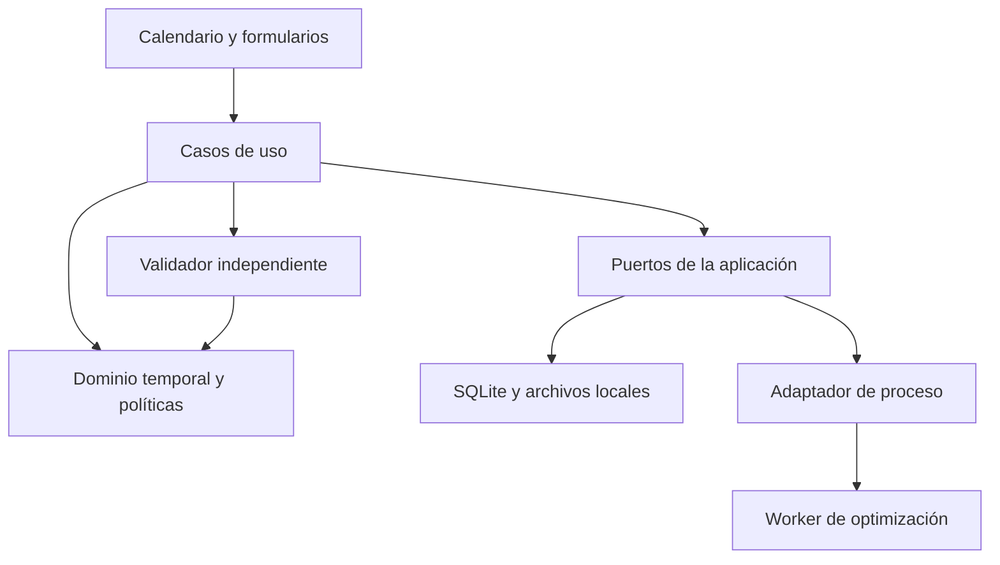

# Arquitectura y distribución

**Decisión de F0.** Monolito modular de escritorio con un proceso de búsqueda local descartable. El encargado necesita que una falla del planificador le permita abrir la semana vigente y seguir trabajando. Por eso el proceso de escritorio conserva las reglas, valida las modificaciones y es el único autorizado a escribir la base. La búsqueda recibe datos de planificación serializados y devuelve opciones.

Las flechas muestran el recorrido de una operación. En código, la capa de aplicación define los puertos y los adaptadores los implementan; el dominio se puede importar solo. La validación no importa el materializador del solver ni confía en su matriz de cobertura. Puede compartir tipos, conversión horaria y aritmética de intervalos probada.

## Componentes y contratos de uso

| Módulo previsto | Responsabilidad y superficie mínima | Falla que debe contener |
|---|---|---|
| `app/domain/` | Tipos inmutables PersonaId, FechaOperativa, IntervaloReal, Jornada, Asignación, ReglaVigente. Resolución de fechas y políticas tipadas. Funciones puras para superposición, duración y elegibilidad. | Valores imposibles y ambigüedades con error localizado, sin correcciones silenciosas. |
| `app/application/` | Casos de uso y límites transaccionales. Construye instantánea coherente y materializa opciones autorizadas para el worker. Compone calendario publicado, edición y vecinos para la validación final. | Actualización obsoleta, dato faltante, conflicto de dominio o error de infraestructura tienen resultados distintos. |
| `validation/` | `validar(asignaciones, reglasFuente, contexto, alcance) → informe`. Hallazgo con código, severidad, persona/regla/fecha/tramo y cantidades esperada y observada. Agrega estado comprobado, incompleto o incompatible. | Rechazar una asignación inválida enviada por cualquier adaptador; conservar evidencia reproducible independiente de CP. |
| `optimizer/contract/` y `optimizer/solver/` | El primero contiene los tipos/mensajes del [contrato 1.0](09_OPTIMIZER_CONTRACT.md). El segundo transforma el catálogo a CP-SAT. Capacidad, presupuestos, cancelación y diagnóstico forman parte del límite. | Sin acceso al archivo de datos, red o Qt. Una respuesta parcial, caducada o estructuralmente errónea no cambia horarios. |
| `app/infrastructure/` | Adaptadores SQLite, reloj de sistema, proceso local, JSON, copia consistente y restauración, PDF/PNG. Rutas de usuario por instalación. | Indisponibilidad de disco/directorio o motor: preservar el último estado guardado y explicar cómo recuperar. |
| `app/ui/` | Presentadores y widgets nativos. Renderizar problemas por texto/fecha, declarar nombres accesibles, mantener selección y foco tras deshacer/cancelar. | Una espera de SQLite, exportación o búsqueda prolongada no debe congelar la ventana. |
| Composición y pruebas | Punto de entrada enlaza adaptadores. En tests, reloj fijo, repositorio temporal y motor simulado. Con motor ausente cargar ruta manual. | Ninguna importación de OR-Tools es necesaria para abrir un horario manual. |

### Fronteras entre módulos, además del protocolo del motor

Nombres orientativos de métodos; sus precondiciones y efectos son normativos para implementación.

| Puerto o caso de uso | Entrada → salida | Garantía |
|---|---|---|
| `cargar_semana` | fecha local + modo vigente/borrador/revisión → celdas, identidad de revisión y alertas | Una lectura coherente; las franjas nocturnas consultan el día vecino. |
| `guardar_borrador` | ID de borrador, versión esperada, cambios exactos → versión persistida o conflicto | Autoguardado transaccional. Errores no se muestran como guardados. |
| `resolver_reglas` | revisión de configuración y fechas → reglas tipadas, procedencia y campos faltantes | Si dos reglas aplicables entran en conflicto, exhibir ambas. |
| `preparar_busqueda` | operación, rango editable, base y opciones → bytes de contrato + token | Misma captura de calendario, reglas, autorizaciones e historia para todo el intento. |
| `comenzar / cancelar / recibir` | mensaje y requestId → evento de terminación correlacionado | Proceso local conocido, una búsqueda activa por ventana; la edición manual permanece disponible. |
| `confirmar` | intento idempotente, borrador, rango autorizado, versión base y token → ID de nueva revisión o problemas | Validar contenido combinado, verificar revisiones bajo transacción y mover la cabeza una vez. Si cambia un dato entre comprobaciones, volver a validar antes de publicar. |
| `exportar_horario` | revisión confirmada, rango y destino → archivo verificado o error | Leer los nombres y el horario asociados a esa revisión, limitar los campos visibles y evitar informes parciales. |
| `importar_configuracion / restaurar` | archivo local + previsualización aceptada → resultado con copia previa | Son operaciones diferentes. Validar contenido, integridad y compatibilidad antes de activar. [Procedimiento](11_IMPORT_EXPORT.md). |

### Elección de tecnologías

| Opción | Motivo de adopción o reconsideración | Comprobación pendiente |
|---|---|---|
| Python y PySide6 con Qt Widgets | Un lenguaje para dominio, bindings de CP-SAT y QA. El modelo/vista de Qt da una base para tabla semanal y selección por teclado. Para la línea diaria, ofrecer también lista textual accesible. | Revisar licencia aplicable a cada módulo Qt y redistribuible, avisos exigidos y canal elegido; validar lector de pantalla, fuentes y escalado reales. [Modelo/vista Qt](https://doc.qt.io/qtforpython-6/overviews/qtwidgets-model-view-programming.html) · [Licencias Qt for Python](https://doc.qt.io/qtforpython-6/licenses.html) |
| SQLite mediante biblioteca estándar | Proporciona transacciones y copia en línea; facilita instalar un solo programa sin administrar un servidor. Un único escritor coincide con el escenario de un encargado. | Probar migraciones interrumpidas, permisos, falta de espacio y recuperación. [Copia oficial SQLite](https://www.sqlite.org/backup.html) · [Interfaz Python](https://docs.python.org/3/library/sqlite3.html) |
| OR-Tools CP-SAT | Adecuado para selección binaria de patrones, restricciones temporales y prioridades enteras. La viabilidad de los tiempos de cálculo depende del número de patrones y bordes. | Comparar con enumeración y medir el mes sintético en la máquina elegida. [Planificación de personal](https://developers.google.com/optimization/scheduling/employee_scheduling) · [Modelo entero y resultados](https://developers.google.com/optimization/cp/cp_solver) |
| Pytest | Tablas paramétricas y utilidades de tests temporales para expresar invariantes y repetir casos con las mismas entradas. | Lock por plataforma e informes que separen simulación, prueba de dominio, integración y piloto. [Parametrización oficial](https://docs.pytest.org/en/stable/how-to/parametrize.html) |
| Alternativa C#/.NET + WPF + OR-Tools .NET | WPF ofrece controles y data binding para Windows y existe distribución de OR-Tools para .NET. Es alternativa razonable si el equipo y el despliegue demuestran ventaja en esa plataforma. Cambiar ahora obliga a sustituir prototipos de dominio, pruebas y adaptadores previstos para Python, sin mediciones que lo justifiquen. | Reabrir ADR si el ensayo Windows evidencia un problema importante de mantenimiento, licencia o despliegue. [Microsoft WPF](https://learn.microsoft.com/en-us/dotnet/desktop/wpf/overview/) · [OR-Tools .NET](https://developers.google.com/optimization/install/dotnet) |

La enumeración completa queda como oráculo de instancias pequeñas. El motor de patrones y contrato admite otra formulación futura. Un segundo runtime de interfaz web, un servicio de base de datos o un sistema de plugins añadirían integración y distribución a una herramienta de un solo local.

## Diseño de entrega Windows

1. Seleccionar una versión de Windows/arquitectura representativa con el encargado y comprobar intersección de versiones soportadas de Python, PySide6, OR-Tools, tzdata y empaquetador. Capturar versiones exactas verificadas, wheel hashes, versión de SQLite efectiva, arquitectura y licencias. F0 no fija versiones de binarios sin haber probado la combinación. Preparar entorno de compilación aparte de la PC de uso. [Instalaciones reproducibles con hashes](https://pip.pypa.io/en/stable/topics/secure-installs/)
2. Evaluar `pyside6-deploy` en modo `standalone`: directorio de aplicación más worker conocido invocable con ruta absoluta. Un instalador offline por usuario, por ejemplo Inno Setup tras revisar términos, incorpora binarios, runtime, plugins Qt estrictamente necesarios, `tzdata`, OR-Tools y dependencias nativas. Fijar la configuración de build. No depender de paquetes descargados en el primer inicio. [Empaquetado de Qt](https://doc.qt.io/qtforpython-6/deployment/deployment-pyside6-deploy.html) · [Inno Setup](https://jrsoftware.org/inno-setup) · [Datos horarios en Windows](https://docs.python.org/3/library/zoneinfo.html)
3. Proponer tuberías del proceso local gestionadas por adaptador, sin puertos de red; con Qt puede usarse QProcess asíncrono. Arrancar por ruta validada del paquete, con argumentos fijos y límite de tamaños. La capa de aplicación decide sobre trabajo tardío. [QProcess](https://doc.qt.io/qt-6/qprocess.html)
4. Conservar datos de usuario fuera del directorio de instalación. Actualizar con la aplicación cerrada, crear copia previa a migración, verificar integridad y mantener la vía de volver al binario y respaldo compatibles. Una reinstalación no debe inicializar una base vacía encima de la existente. Entregar acceso a la guía local «Guardar y recuperar una copia».
5. F6 usa una VM limpia sin Python, sin red y sin privilegios administrativos habituales, después la PC objetivo. Probar arranque, fuente/diseño a 150–200 %, generación y cancelación real, funcionar con worker retirado, exportación PDF/PNG, actualización con datos sintéticos y restauración en una instalación nueva. Registrar resultados y artefacto de build antes de decidir el piloto.

## Protección y límites de confianza

La cuenta de Windows y sus permisos delimitan el acceso a este producto de un solo usuario. El respaldo portable contiene horarios y datos personales; elegir destino y conservarlo bajo control del responsable. Reducir los datos suministrados al worker y a los logs; evitar valores privados en trazas de error. Verificar tamaño, estructura y referencias de archivos externos sin ejecutar contenido. La integridad de una copia y su confidencialidad requieren controles diferentes. El diseño de F0 no acredita cifrado ni resistencia a un administrador local malicioso. [Modelo y copias](05_DATA_MODEL.md) · [Intercambio y recuperación](11_IMPORT_EXPORT.md)
